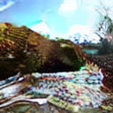
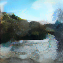

# Actual Android 5.1 phone round trip

This is a real Pixnio photograph, scaled with Lanczos and center-cropped to
128 by 128 pixels before encoding. The phone generated the 137-byte
`phone-encoded128.aeic` file and decoded that same file into
`phone-decoded128.png`. The encoded file is byte-identical to the original
CPU codec. Encoding took 2.172 seconds; complete decoding took 114.477 seconds
and peaked at 242,204 KiB process RSS on the LG L51AL / Android 5.1.1.

| Scaled original | Phone reconstruction |
|---|---|
|  |  |

The small transmitted file relies on the separately installed FT2 learned
models, which occupy about 2 GB. It is lossy; the PNG is a viewing copy, not
the transmitted file. See the [mobile instructions](../../README.md).

## Android app service proof

The Flutter app's `ImageCodecService` also encoded and fully decoded this
128-pixel image on the same Android 5.1.1 phone, through its worker isolate and
native process backend. Before inference, the app verified all 4,724 model files
with streaming SHA-256 checks and created 4,192 controlled shared-weight links.
This test used four native threads.

The app produced the same 137-byte compressed file as the original CPU codec
and the CLI phone example. Service encoding took 3.565 seconds and service
decoding took 124.263 seconds, including 123.770 seconds of native decoding.
Native decode peak RSS was 242,384 KiB. The result was not degraded.

The app's input pixels match the CLI input exactly, and its reconstructed pixels
match the CLI reconstruction exactly. This does not make the codec lossless:
the reconstruction still differs from the original photograph. The PNG below
is a 41,372-byte viewing copy, smaller than the CLI PNG despite identical
reconstructed pixels. See [app-results.json](app-results.json) for hashes
and measurements; [results.json](results.json) retains the separate CLI results.

The app has also encoded the 576-pixel version into the exact 1,783-byte reference
stream. Its full app decode is still pending.

`phone-recovered128.png` is a separate best-effort test. Four bytes were removed
from the compressed file, one renderer layer was missing, and an entropy
reference index was changed. Strict decoding rejected the file; opt-in recovery
produced this explicitly degraded PNG in 137.142 seconds with six recovery
warnings. Recovery cannot restore information that was lost.

Source: [Pixnio river / forest photograph](https://pixnio.com/nature-landscapes/river/landscape-water-nature-tree-river-forest-mountain),
licensed [CC0](https://creativecommons.org/publicdomain/zero/1.0/).
