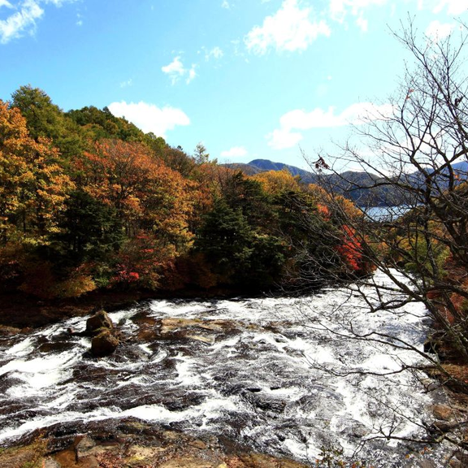
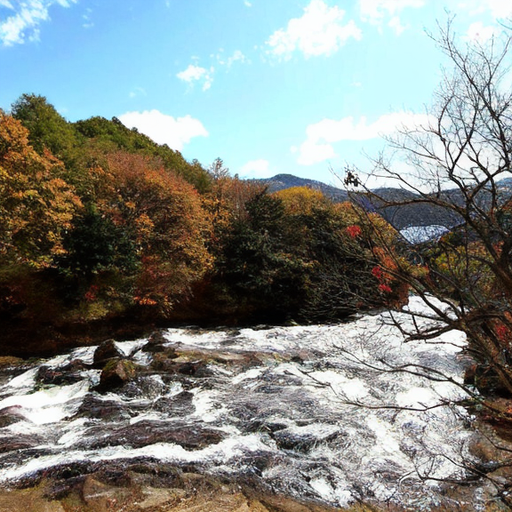

# Actual Android 5.1 phone round trip

This is a real Pixnio photograph, scaled with Lanczos and center-cropped to
128 by 128 pixels before encoding. The phone generated the 137-byte
`phone-encoded128.aeic` file and decoded that same file into
`phone-decoded128.png`. The encoded file is byte-identical to the original
CPU codec. Encoding took 2.172 seconds; complete decoding took 114.477 seconds
and peaked at 242,204 KiB process RSS on the LG L51AL / Android 5.1.1.

| Scaled original | Phone reconstruction |
|---|---|
|  |  |

The small transmitted file relies on the separately installed FT2 learned
models, which occupy about 2 GB. It is lossy; the PNG is a viewing copy, not
the transmitted file. See the [mobile instructions](../../README.md).

## Android app service proof

The Flutter app's `ImageCodecService` also encoded and fully decoded this
128-pixel image on the same Android 5.1.1 phone, through its worker isolate and
native process backend. Before inference, the app verified all 4,724 model files
with streaming SHA-256 checks and created 4,192 controlled shared-weight links.
This test used four native threads.

The app produced the same 137-byte compressed file as the original CPU codec
and the CLI phone example. Service encoding took 3.565 seconds and service
decoding took 124.263 seconds, including 123.770 seconds of native decoding.
Native decode peak RSS was 242,384 KiB. The result was not degraded.

The app's input pixels match the CLI input exactly, and its reconstructed pixels
match the CLI reconstruction exactly. This does not make the codec lossless:
the reconstruction still differs from the original photograph. The PNG below
is a 41,372-byte viewing copy, smaller than the CLI PNG despite identical
reconstructed pixels. See [app-results.json](app-results.json) for hashes
and measurements; [results.json](results.json) retains the separate CLI results.

## Fast and Accurate phone comparison

Real trained convolution stages were first tested with 16×16 spatial inputs,
then the complete 128- and 256-pixel encode/decode cycles were tested on the
same Android 5.1.1 phone with four threads. The following paired trials used
the renderer-mode candidate before the final weight-buffer allocation fix:

| Image | Conservative Accurate | Fast | Compressed bytes |
|---|---:|---:|---:|
| 128 × 128 | 123.298 s | 93.465 s | 137 |
| 256 × 256 | 410.207 s | 261.850 s | 407 |

Each image passed all 10 encoder and 9 decoder entropy index/symbol checks.
Peak native RSS was 237,820/238,368 KiB at 128 pixels and
244,304/244,204 KiB at 256 pixels (Accurate/Fast). Fast changed only 16 of
49,152 and 42 of 196,608 RGB channel values respectively, each by one level
out of 255. Full measurements and binary identities are in
[cpu-decoder-results.json](cpu-decoder-results.json).

Fast is the CPU default, while Accurate remains selectable. Above 256 pixels,
Fast retains conservative renderer kernels to protect the older phone's RAM.
The historical 576-pixel proof below remains separate from these CPU trials.

The final shipped ARMv7 binary, including the weight-buffer allocation fix,
completed a further 256-pixel phone cycle in 258.846 seconds at 244,016 KiB.
Its 407-byte compressed file and decoded PNG are byte-identical to the earlier
Fast candidate. The final app service encoded 128 pixels in 2.024 seconds and
decoded in 89.325 seconds, including a deliberate pause; native decoding took
88.928 seconds at 238,280 KiB. Accurate pause/cancel left no PNG or worker,
and Fast pause/resume reached kernel states T/R and completed with zero active
jobs. The normal full app was then installed; both mode choices were checked
in Settings, with Fast left selected.

The final AVX2/OpenMP desktop build in the eight-vCPU i5-14600K VM decoded
128 pixels in 9.443 seconds Accurate / 8.312 seconds Fast, and 256 in
11.651 / 10.131 seconds. Normal peak native RSS was 315–319 MiB.
The allocation correction preserves all 511 intermediate tensor hashes
within each mode. These desktop results and final phone proofs are also in
the JSON report above. GPU inference was not used.

## 576-pixel app cycle

The updated full app encoded and decoded the 576-pixel version on the same
Android 5.1.1 phone using four threads. Encoding took 12.984 seconds and produced
the exact 1,783-byte CPU reference file. Full app decoding took 2,465.714 seconds
(41 minutes 5.714 seconds), including a deliberate 1.249-second pause. Native
decode peak RSS was 294,092 KiB (287.2 MiB). The saved 755,951-byte PNG contains
995,328 RGB bytes and is not degraded. It remains a lossy reconstruction.

| Scaled original, 576 × 576 | PNG after the phone's encode/decode cycle |
|---|---|
|  |  |

The reconstruction differs from the full-precision CPU reference by 0.508 RGB8
levels on average (50.441 dB PSNR); its PSNR against the scaled original is
16.924 dB. Real control tests confirmed kernel state `T` during Pause, state `R`
after Resume, and a removed worker/no PNG/zero active jobs after a separate
128-pixel Cancel. The completed 576 job left no native workers or active jobs.
Hashes and measurements are in [app-results576.json](app-results576.json).
Compared directly with the full native host PNG, only 167 of 995,328 channel
values differ, each by one RGB8 level (85.883 dB PSNR). Pixel byte identity is
not claimed. The native host PNG is unchanged by the memory optimization.
The transmitted [phone-encoded576.aeic](phone-encoded576.aeic) requires the
separately installed model. LoRa framing and parity increase this photograph's
origin transmission to 2,241 bytes before relay-path overhead.

`phone-recovered128.png` is a separate best-effort test. Four bytes were removed
from the compressed file, one renderer layer was missing, and an entropy
reference index was changed. Strict decoding rejected the file; opt-in recovery
produced this explicitly degraded PNG in 137.142 seconds with six recovery
warnings. Recovery cannot restore information that was lost.

Source: [Pixnio river / forest photograph](https://pixnio.com/nature-landscapes/river/landscape-water-nature-tree-river-forest-mountain),
licensed [CC0](https://creativecommons.org/publicdomain/zero/1.0/).
